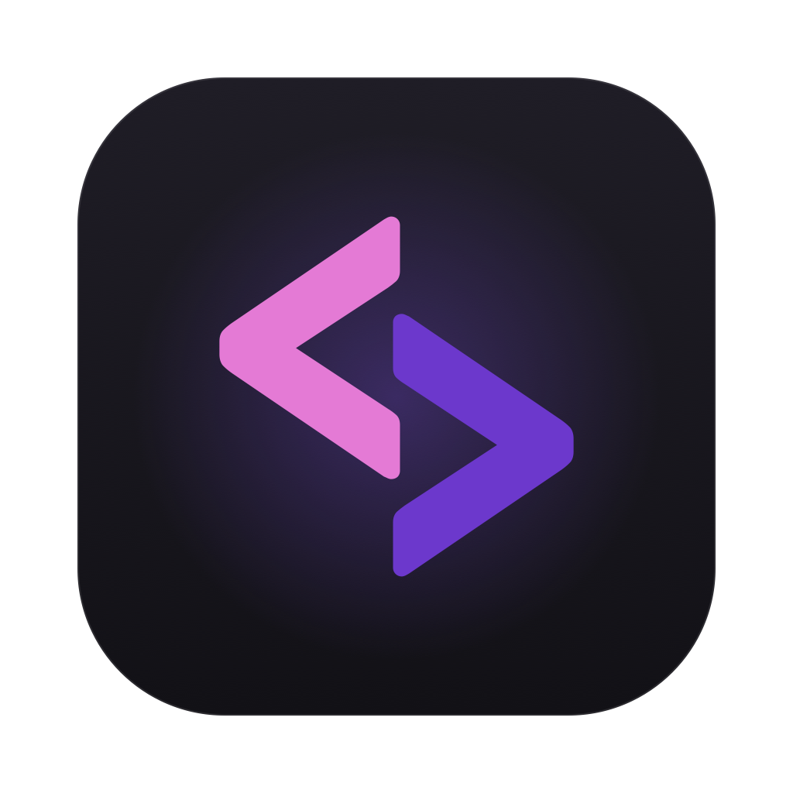
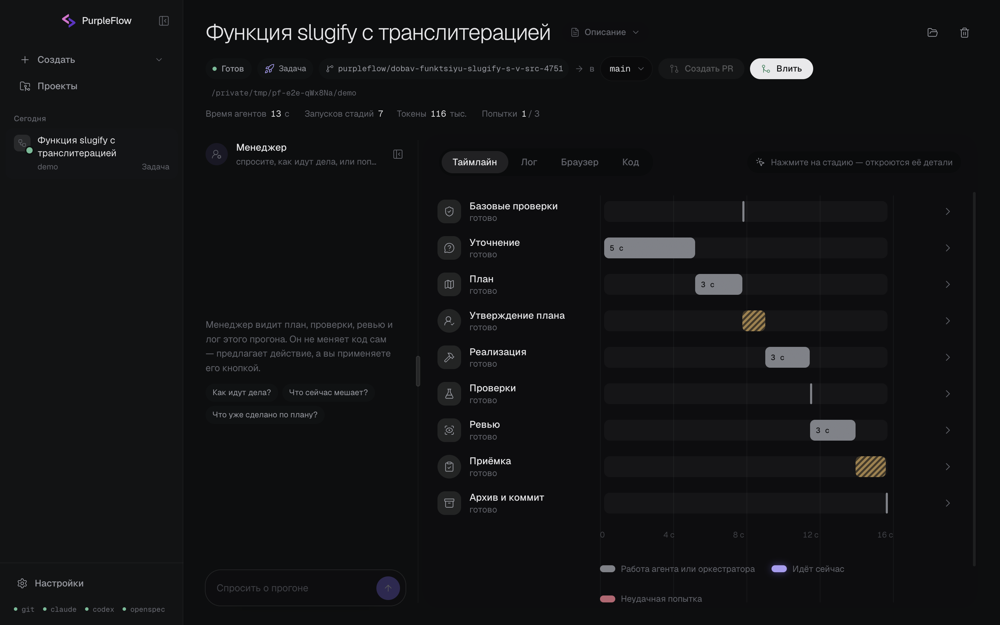
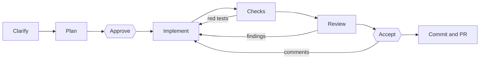
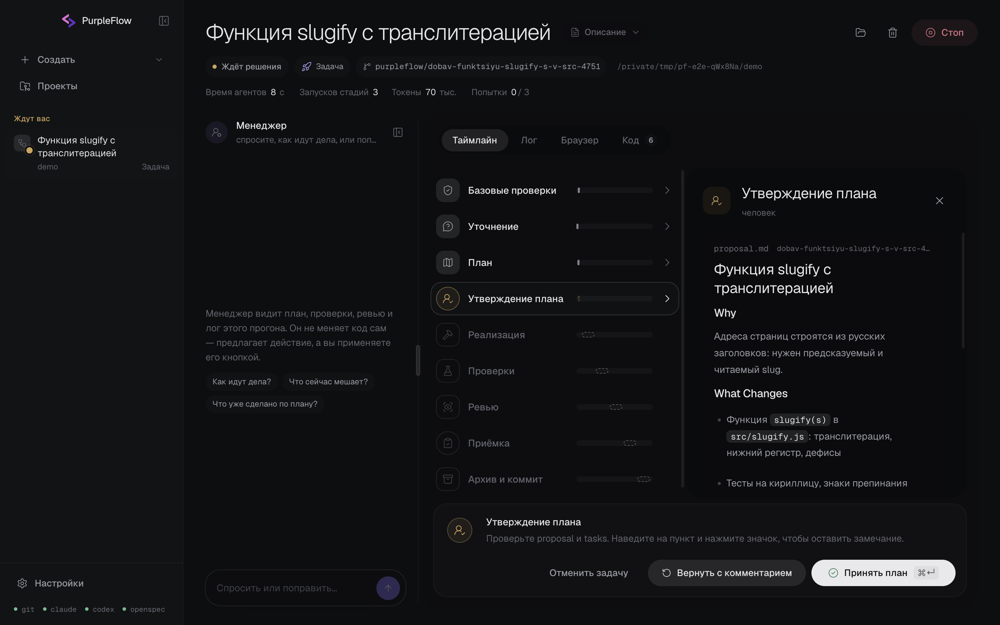
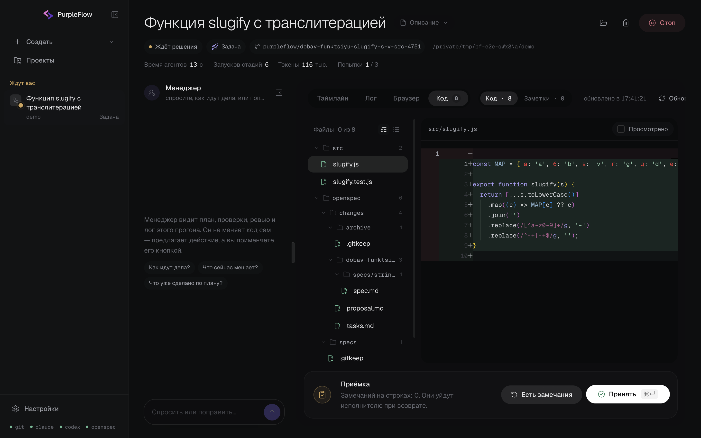

<div align="center">



# PurpleFlow

**Mission control for your AI coding agents**

A free desktop app that walks Claude Code and Codex through fixed stages: one agent writes code from a plan you approved, another reviews it, tests and a browser check the result — and you accept what's finished.

[](https://github.com/PurpleSchool/purpleflow/actions/workflows/ci.yml)
[](https://github.com/PurpleSchool/purpleflow/releases/latest)
[](LICENSE)

-3b3d45)

[**Download**](https://github.com/PurpleSchool/purpleflow/releases/latest) · [Getting started](#getting-started) · [Architecture](ARCHITECTURE.md) · [Contributing](CONTRIBUTING.md) · [Русский](README.md)



</div>

> The interface, prompts and code comments are in Russian. Issues and pull requests in English are welcome.

## Why

An agent in a terminal plans on its own, writes on its own and decides on its own that everything works. PurpleFlow separates those roles: **whoever writes the code doesn't accept it**. It has no agent of its own — each stage runs the [Claude Code](https://docs.anthropic.com/en/docs/claude-code) or [Codex](https://github.com/openai/codex) CLI you already have.

| | Agent in a terminal | PurpleFlow |
| --- | --- | --- |
| Models | One for everything | Planner, executor and reviewer, each with its own model |
| Tests and linter | When the agent feels like it | Required; red tests go back to the executor |
| Review | None | A different model checks the diff against the plan |
| Browser check | None | A separate agent looks at the running app |
| Your part | Reread the whole diff | Approve the plan, accept the result |

## How a task runs



<table>
  <tr>
    <td width="50%"></td>
    <td width="50%"></td>
  </tr>
  <tr>
    <td><b>Plan approval.</b> See what the agent will do before the first line of code.</td>
    <td><b>Acceptance.</b> The diff, reviewer findings and your line comments, then merge or open a PR.</td>
  </tr>
</table>

## Features

- **Modes:** quick fix, bug (a failing test reproduces the bug first), task, large task (design plus phased implementation), refactoring (checks must be green before and after).
- **Roles:** for planner, executor and reviewer you choose `claude` or `codex` and a model. By default the reviewer is a different model from the executor.
- **Gates:** you approve the plan, answer clarifying questions, and accept the result in a Monaco diff with line comments. From acceptance you can request a quick fix.
- **Checks:** lint and tests run against the run's worktree. They are compared with the base commit, so pre-existing failures are not blamed on the task. Flaky tests are detected and retried.
- **Visual check:** the app from the run's branch starts on a free port. The agent drives a browser and takes screenshots for acceptance.
- **Project knowledge:** a project profile and lessons from past runs are added to every agent's prompt.
- **Run manager and on-the-fly control:** add a note for the executor, pause, restart implementation or go back to the plan.
- **Parallel runs:** a queue with a configurable limit.
- **PRs on GitHub** via `gh`, with CI status and a follow-up round on review comments.
- **Chat:** talk to an agent outside the pipeline and turn the conversation into a task.

## Getting started

You need Node.js ≥ 22.18, git, and the agents:

```bash
npm i -g @anthropic-ai/claude-code @openai/codex @fission-ai/openspec
```

```bash
npm install
```

```bash
npm run dev
```

On first launch the app finds `git`, `claude`, `codex` and `openspec` in your login shell's PATH. You can also point to each tool manually.

The optional PurpleSchool account provides an AI proxy for `claude` and `codex`. Without an account, the agents run on your own subscriptions. To remove the account entirely (sign-in screen, Account and Usage tabs, default proxy URLs), run or build with `PURPLEFLOW_ACCOUNT=off`. Everything provider-specific lives in `app/src/main/provider.ts`.

**Updates and releases.** The app checks GitHub releases on launch and every 6 hours and offers to update; downloading and restarting happen on a button press. To release, run `npm run release -- 0.2.0` from `main`: the tag makes CI build all platforms into a draft release, and users get the update once you publish the draft. This needs a public repository and, for macOS, Developer ID signing secrets (see the Russian README): an unsigned macOS app can't update itself and shows a manual download link instead.

## Building

```bash
npm run dist:mac -w @purpleflow/app
```

`dist:win` and `dist:linux` work the same way. The output goes to `app/release/`. Signing and notarization settings are described in the Russian README, in the «Сборка» section.

## Development

```bash
npm run check
```

This runs typecheck, ESLint, Prettier and tests, the same as CI. The pipeline tests drive a whole run on a temporary git repository with real git and openspec and fake agents. They need neither `claude` nor `codex` and finish in seconds.

Window end-to-end tests and the real-CLI check run separately:

```bash
npm run test:e2e                      # real window and git, fake claude; spends no tokens
npm run check:agents -w core          # claude and codex versions, gh output format
npm run check:agents -w core -- --live  # also a short request to the agents; spends tokens
```

A sample project to try a run on:

```bash
npm run make-sample -- ~/purpleflow-sample
```

## Repository layout

```
core/       orchestrator core, plain TypeScript, no Electron
  src/      kernel → stages/ + services/ → engine → orchestrator (see ARCHITECTURE.md)
  prompts/  stage prompts and the reviewer's JSON schema
app/        Electron + electron-vite + React; the core runs in a utilityProcess
examples/   sample projects for trying runs end to end
```

See [ARCHITECTURE.md](ARCHITECTURE.md) for the process model, the core's layers and the IPC contract. The architecture doc is in Russian; the diagrams and file names should be easy to follow.
