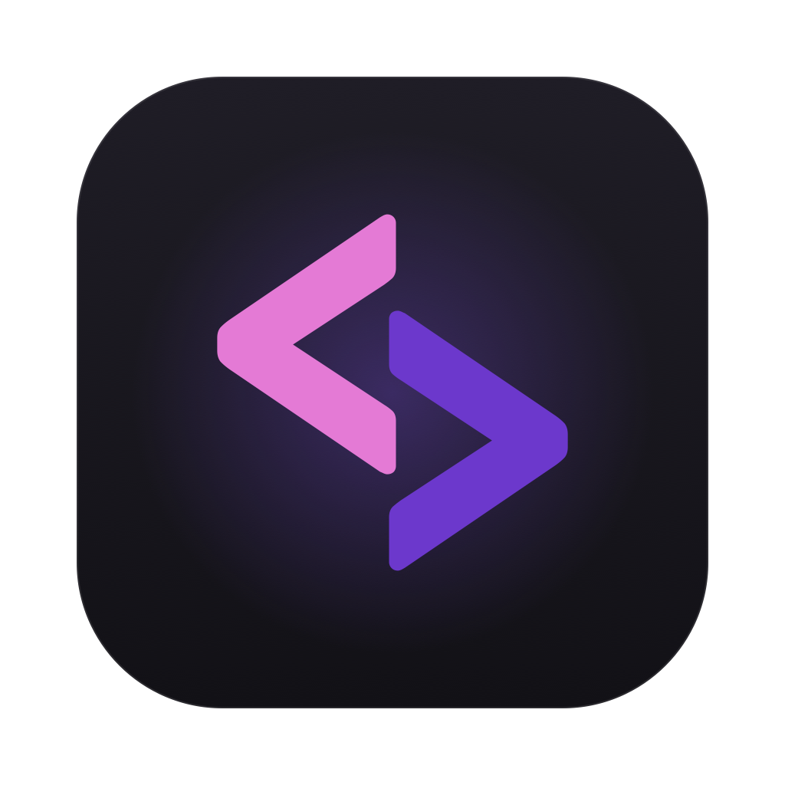
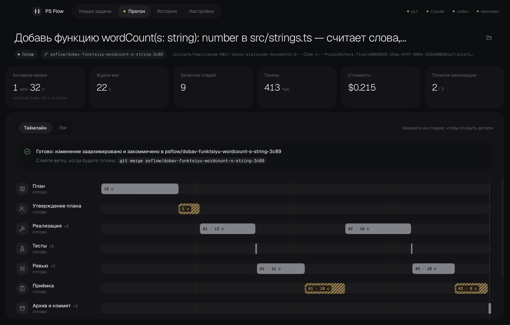
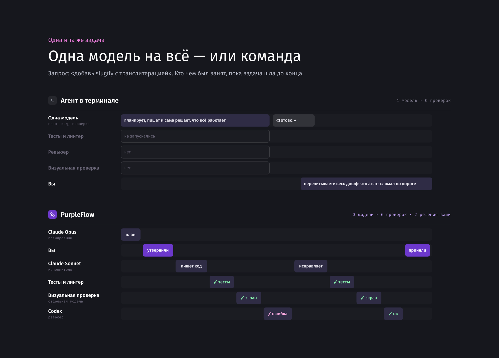
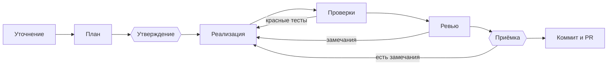
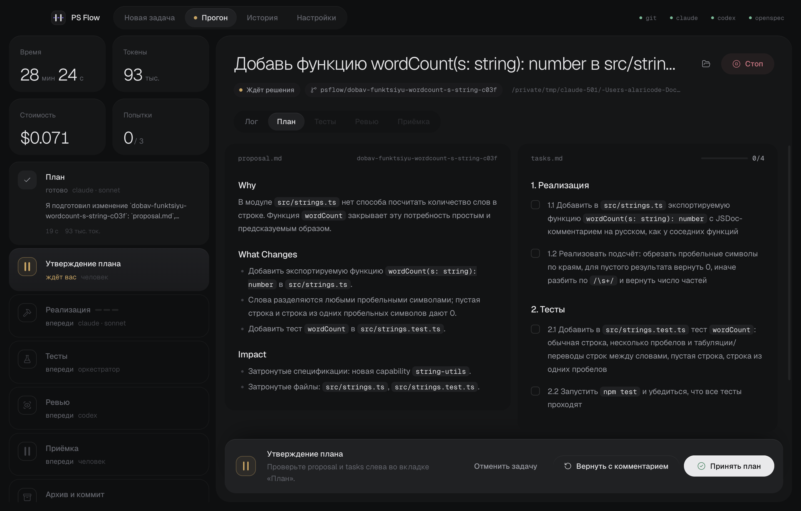
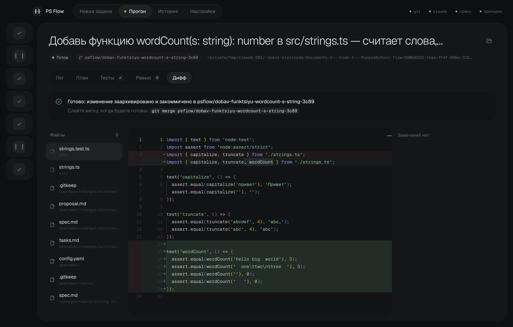

<div align="center">



# PurpleFlow

**Штаб для ваших ИИ-агентов**

Бесплатное приложение для компьютера, которое ведёт Claude Code и Codex по шагам: один агент пишет код по утверждённому вами плану, другой делает ревью, тесты и браузер проверяют результат — а вы принимаете готовое.

[](https://github.com/PurpleSchool/purpleflow/actions/workflows/ci.yml)
[](https://github.com/PurpleSchool/purpleflow/releases/latest)
[](LICENSE)

-3b3d45)

[**Скачать**](https://github.com/PurpleSchool/purpleflow/releases/latest) · [Быстрый старт](#быстрый-старт) · [Руководство](docs/guide.md) · [Архитектура](ARCHITECTURE.md) · [Как участвовать](CONTRIBUTING.md) · [English](README.en.md)



</div>

## Зачем это нужно

Агент в терминале сам планирует, сам пишет и сам решает, что всё работает. PurpleFlow разводит эти роли: **тот, кто пишет код, его не принимает**.



Своего агента в PurpleFlow нет: стадии выполняют установленные у вас `claude` и `codex`. Приложение отвечает за порядок, проверки и ваши решения.

## Как идёт задача

Агент не перескочит ни одну стадию: красные тесты или замечание ревьюера возвращают задачу исполнителю. На двух стадиях решаете вы.



<table>
  <tr>
    <td width="50%"></td>
    <td width="50%"></td>
  </tr>
  <tr>
    <td><b>Утверждение плана.</b> Видите, что агент сделает, до первой строчки кода.</td>
    <td><b>Приёмка.</b> Дифф, замечания ревьюера и ваши комментарии к строкам. Затем «Влить» или «Создать PR».</td>
  </tr>
</table>

## Возможности

| | |
| --- | --- |
| **Быстрая настройка** | Выберите основного агента и пресет — «Экономный», «Оптимальный» или «Максимальное качество» — и роли с моделями расставятся сами. Ревьюер всегда работает на другой модели, чем исполнитель. |
| **Разные модели на разных ролях** | Любую роль можно поправить вручную: планировщику, исполнителю и ревьюеру — свой `claude` или `codex` и своя модель. Больше всего работы на реализации: туда можно поставить модель подешевле, а план и ревью оставить сильной. |
| **Режимы под задачу** | Быстрая правка, баг (сначала падающий тест), задача, большая задача по этапам, рефакторинг (тесты зелёные до и после). Не знаете, что выбрать, — нажмите «Авто». |
| **Обязательные проверки** | Тесты и линтер проекта. Команды определяются сами для Node.js, Go, Python и Rust, для остальных указываются вручную. |
| **Визуальная проверка** | Отдельный агент открывает приложение в браузере и смотрит на результат. |
| **Изоляция** | Каждая задача — отдельная worktree и ветка `purpleflow/…`. Ваша рабочая копия не меняется, влить или открыть PR решаете вы. |
| **Pull request** | Создание PR на GitHub, отработка замечаний ревьюеров и упавших проверок CI. |
| **Менеджер прогона** | Чат рядом с прогоном: спросите, как идут дела, или поправьте ход. |
| **Восстановление** | Закрыли приложение на середине — прогон можно продолжить после запуска. |

## Быстрый старт

**1. Скачайте PurpleFlow** со страницы [Releases](https://github.com/PurpleSchool/purpleflow/releases/latest) для macOS, Windows или Linux. При первом запуске кнопка «Настроить» сама поставит недостающие Node.js, `claude`, `codex` и OpenSpec. Отдельно понадобится только git. Дальше приложение будет предлагать обновления.

Можно поставить агентов и вручную:

```bash
npm i -g @anthropic-ai/claude-code @openai/codex @fission-ai/openspec
```

**2. Опишите задачу:** выберите папку проекта и режим. PurpleFlow позовёт вас только на утверждение плана и приёмку.

<details>
<summary>Запуск из исходников</summary>

Нужны Node.js ≥ 22.18 и git.

```bash
git clone https://github.com/PurpleSchool/purpleflow.git
```

```bash
cd purpleflow && npm install
```

```bash
npm run dev
```

Сборка установщиков и подпись — в [руководстве](docs/guide.md#сборка).

</details>

## На чём работать

Приложение бесплатно в обоих случаях.

| Свои подписки | Токены PurpleSchool |
| --- | --- |
| Claude Pro / Max или ChatGPT Plus / Pro: PurpleFlow запускает Claude Code и Codex под вашим входом. Нажмите «Пропустить» при первом запуске — регистрация не нужна, расход идёт из лимитов подписки. | Нет зарубежной карты или не хватает лимитов? Все модели через одну подписку: оплата картой российского банка, без VPN. Запросы агентов идут через AI-прокси PurpleSchool. |

## Ваш код остаётся вашим

- PurpleFlow работает на вашем компьютере. Код получает только выбранный вами агент и его провайдер моделей, а с токенами PurpleSchool запросы проходят через наш AI-прокси.
- Изменения попадают только в отдельную ветку, а слияние всегда за вами.
- Если приложение падает, разработчики получают отчёт об ошибке: тип, стек, версии приложения и системы. Код, задачи, пути и ключи вычищаются до отправки, а отключить отчёты можно в настройках на вкладке «Приложение».
- Код открыт: можно прочитать, что именно делает каждая стадия, — [промпты стадий](core/prompts) лежат в репозитории.

## Статус

Проект в **beta**: основные сценарии покрыты тестами, но возможны ошибки. Начинайте с проектов, где легко откатиться.

| ОС | Поддержка |
| --- | --- |
| macOS | ✅ проверки и сквозные тесты окна в CI при выпуске версии, живая проверка |
| Linux | ✅ проверки и сквозные тесты окна в CI |
| Windows | 🧪 экспериментально: проверки ядра и окна в CI, без сквозных тестов и живой проверки |

## Участие в проекте

Ошибки и идеи — в [Issues](https://github.com/PurpleSchool/purpleflow/issues), как собрать проект и прогнать проверки — в [CONTRIBUTING](CONTRIBUTING.md), об уязвимостях — по правилам из [SECURITY](SECURITY.md). Интерфейс, промпты и комментарии в коде на русском; issues и pull request на английском тоже приветствуются.

Хотите научиться работать с агентами? В [курсах PurpleSchool](https://purpleschool.ru) есть программы по Claude Code и Codex.

## Лицензия

[MIT](LICENSE) © PurpleSchool
